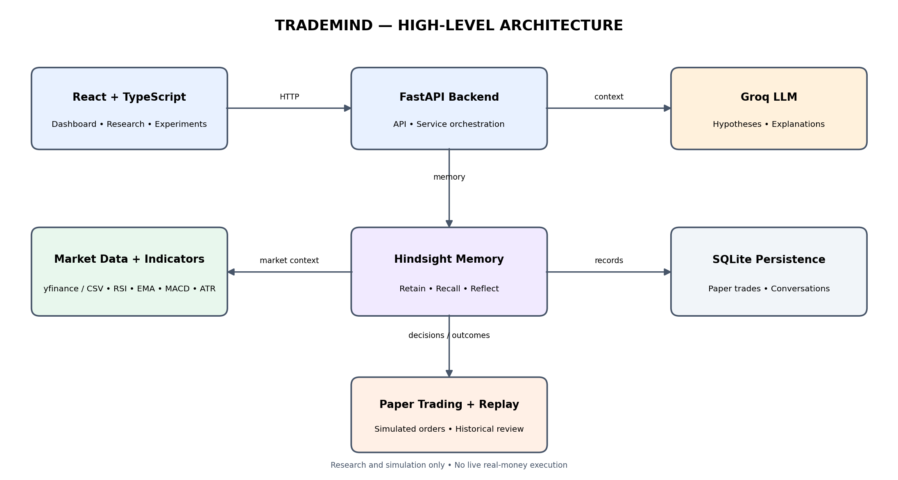
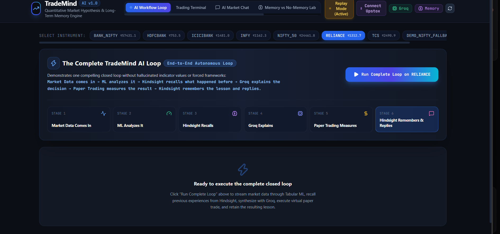
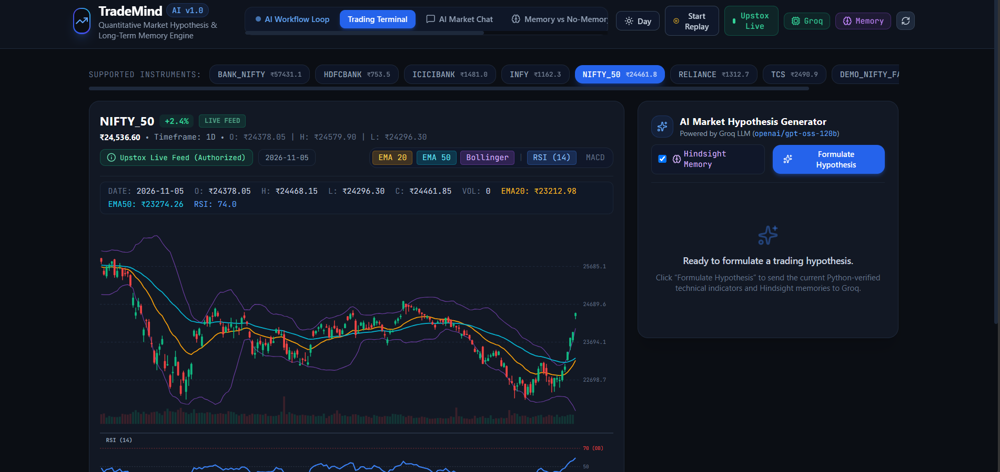
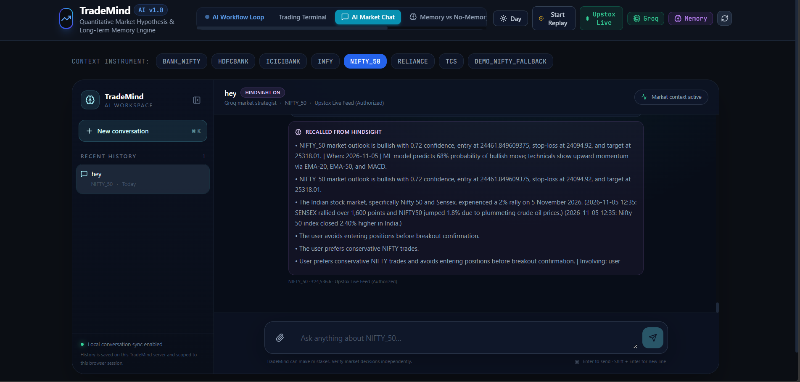
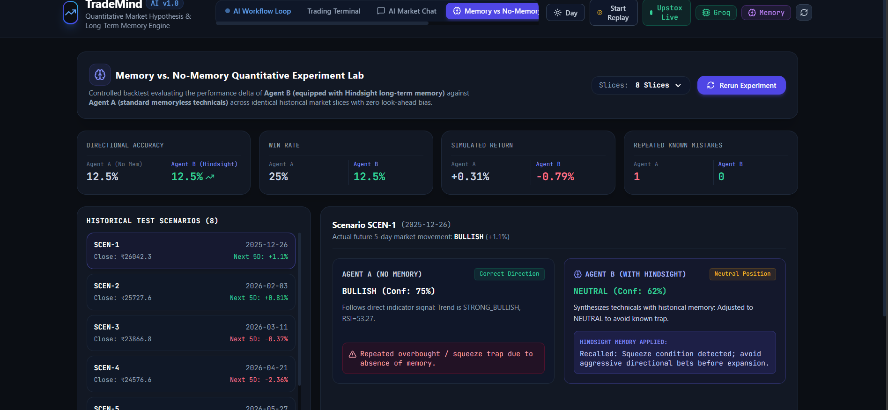

# TradeMind AI

<p align="center">
  
</p>

<p align="center"><strong>AI-assisted trading research, paper trading, and persistent agent memory.</strong></p>

<p align="center">
  
  
  
  
  
  
</p>

---

## Overview

**TradeMind AI** is an experimental trading research platform that combines quantitative market analysis, machine-learning signals, large-language-model reasoning, and long-term experiential memory.

Traditional chat assistants may lose useful context between sessions. TradeMind explores a memory-augmented workflow: retain relevant trading preferences, hypotheses, and lessons in **Hindsight**, retrieve related memories when needed, and use that context to support later research.

TradeMind is intended for learning, research, and simulated trading. **It does not execute live real-money trades and is not a financial-advice product.**

## The problem

A research assistant may produce a useful analysis in one session but fail to apply the same preference or lesson in a later session. It can also be difficult to connect market indicators, previous hypotheses, and recorded simulated outcomes in one consistent workflow.

TradeMind brings these capabilities together:

- Inspect historical market data and calculate technical indicators.
- Generate and review research hypotheses with an LLM.
- Retain useful experiences and retrieve relevant memories later.
- Explore ideas through experiment-oriented workflows.
- Review simulated trades and historical scenarios.

## Features

## Screenshots

### Dashboard
<p align="center">
  
</p>

### Trading Analysis
<p align="center">
  
</p>

## Screenshots

### ChatBot
<p align="center">
  
</p>

### HindSight
<p align="center">
  
</p>

### Quantitative market analysis

TradeMind works with historical market data from configured providers or CSV input. The analysis layer includes:

| Indicator | Purpose |
|---|---|
| RSI (14) | Momentum and overbought/oversold context |
| EMA (20/50/200) | Trend and moving-average context |
| MACD (12/26/9) | Momentum and trend-change context |
| Bollinger Bands (20, 2) | Volatility and relative price range |
| ATR (14) | Average range / volatility estimation |

Indicators are analytical inputs, not standalone buy or sell instructions.

### Machine-learning signals

The project includes experimental ML components:

- Random Forest classifier for directional classification.
- Gradient Boosting regressor for volatility estimation.
- Volume-flow component used as an additional sentiment-style signal.

Treat model outputs as experimental. Their reliability depends on data quality, validation methodology, and changing market conditions.

### LLM-assisted research with Groq

The backend integrates a Groq-hosted language model for natural-language explanations and hypothesis-oriented workflows. The LLM interprets available context; it does not replace market data or quantitative calculations.

### Persistent experiential memory with Hindsight

Hindsight provides the memory layer used to retain and retrieve useful context across interactions.

1. **Retain:** store a relevant preference, observation, hypothesis, or lesson.
2. **Recall:** retrieve related memories when a future question needs that context.
3. **Reflect:** review previous experiences and outcomes where supported by the workflow.
4. **Reason:** provide relevant retrieved context to the LLM-assisted research step.

Hindsight is a memory system, not a model-training or fine-tuning process. Saving a memory does not retrain the Groq model.

Useful links:
- [Hindsight GitHub](https://github.com/vectorize-io/hindsight)
- [Hindsight documentation](https://hindsight.vectorize.io/)
- [What is agent memory?](https://vectorize.io/what-is-agent-memory)

### Experimentation and hypothesis review

TradeMind includes an experiment-oriented workflow for exploring trading hypotheses and reviewing the signals and context associated with them. Validate experimental outputs against reproducible historical data before drawing conclusions.

### Paper trading

The paper-trading module supports simulated order and portfolio workflows. The configured starting balance is **₹1,00,000**. Fee/tax and slippage assumptions are configurable in the application.

These are simulation assumptions, not actual broker charges or guaranteed execution prices.

### Historical replay

Historical replay supports reviewing a market scenario against past data. Results depend on the quality of the historical data and the assumptions used by the simulation.

### Optional Upstox connection

The project includes an optional Upstox OAuth integration path. Availability depends on valid credentials, account permissions, and broker-side API access. An OAuth connection should not be interpreted as permission for live order execution.

## Technology stack

| Layer | Technologies |
|---|---|
| Frontend | React 18, TypeScript, Vite, Tailwind CSS |
| Backend | Python, FastAPI, Uvicorn |
| LLM | Groq API |
| Memory | Vectorize Hindsight (`hindsight-client`) |
| Data analysis | pandas, NumPy, `ta`, yfinance |
| Machine learning | scikit-learn |
| Persistence | SQLite |
| Broker integration | Optional Upstox OAuth |

## Architecture

The diagram at the top of this README illustrates the high-level system:

- React frontend sends requests to FastAPI.
- FastAPI coordinates market analysis and application services.
- Hindsight stores and retrieves experiential context.
- SQLite stores application records such as paper-trading and conversation data.
- Paper trading and replay support simulation and review.

## Project structure

The repository is organized into frontend and backend areas. File names may evolve as development continues.

```text
TradeMind/
├── backend/
│   ├── main.py
│   ├── routers/
│   └── services/
├── frontend/
│   ├── src/
│   ├── package.json
│   └── vite.config.ts
├── docs/
│   └── images/
│       └── trademind-architecture.png
├── requirements.txt
├── .env.example
└── README.md
```

If `.env.example` is not present in your checkout, create one using the variable names referenced by your current backend code. Never put real secrets in it.

## Getting started

### Prerequisites

- Python 3.10 or later, subject to dependency compatibility.
- Node.js and npm.
- Git.
- API credentials for external services you want to enable.

### 1. Clone the repository

```bash
git clone https://github.com/naraenks2007-lgtm/TradeMind.git
cd TradeMind
```

### 2. Create a virtual environment

Windows PowerShell:

```powershell
python -m venv .venv
.venv\Scripts\Activate.ps1
```

Windows Command Prompt:

```bat
python -m venv .venv
.venv\Scripts\activate
```

macOS / Linux:

```bash
python3 -m venv .venv
source .venv/bin/activate
```

### 3. Install backend dependencies

```bash
python -m pip install --upgrade pip
pip install -r requirements.txt
```

### 4. Configure environment variables

Create a `.env` file in the project root. Add only the credentials and configuration required by the services you enable.

Illustrative example:

```env
GROQ_API_KEY=your_groq_api_key
HINDSIGHT_API_KEY=your_hindsight_api_key
# Add Hindsight endpoint/project settings required by your deployment.
# Add Upstox OAuth credentials only if using that optional integration.
```

**Important:** These variable names are examples. Check the actual names read by your current backend code and Hindsight deployment. Never commit `.env`, API keys, access tokens, or refresh tokens.

### 5. Start the backend

From the repository root:

```bash
python -m uvicorn backend.main:app --reload --host 127.0.0.1 --port 8000
```

FastAPI documentation is normally available at:

- http://127.0.0.1:8000/docs
- http://127.0.0.1:8000/redoc

### 6. Start the frontend

Open a second terminal:

```bash
cd frontend
npm install
npm run dev
```

Open the local URL printed by Vite (commonly `http://localhost:5173`).

## Suggested demo workflow

1. Open the TradeMind dashboard.
2. Select a supported symbol or load available historical data.
3. Review market indicators and model-generated signals.
4. Ask the research assistant to explain a setup or formulate a hypothesis.
5. Save a meaningful preference or lesson through the memory workflow.
6. Start a separate interaction and ask a related question to test whether relevant Hindsight context is recalled.
7. Explore the idea using experiment or paper-trading workflows without placing a real order.
8. Review the recorded result and limitations.

For a credible memory demonstration, show the actual retain operation, subsequent recall, and returned memory. Do not present a hard-coded response as proof of retrieval.

## Responsible use and limitations

- **Paper trading only:** This project is for simulation and research, not live financial execution.
- **No investment advice:** AI-generated explanations and model outputs can be wrong.
- **Historical-data limitations:** Historical or delayed data is not equivalent to a real-time exchange feed.
- **Model limitations:** ML models can overfit and may fail when market conditions change.
- **LLM limitations:** Language models can produce incorrect or unsupported explanations. Verify claims against source data.
- **Memory limitations:** Retrieved memories may be incomplete, outdated, or irrelevant. Review important context before relying on it.
- **Credential safety:** Keep API keys and OAuth tokens private and outside source control.
- **Production readiness:** Authentication, per-user memory isolation, monitoring, security hardening, and robust validation are important before multi-user production deployment.

<<<<<<< HEAD
## Future improvements

- Stronger walk-forward and out-of-sample model evaluation.
- More comprehensive experiment tracking and reproducibility.
- Explicit provenance and timestamps for retained memories.
- User-scoped memory isolation and access controls.
- Better risk metrics and portfolio-level simulation.
- Automated tests for market-data, memory, and paper-trading workflows.
- Improved handling of unavailable providers and offline demo data.

## Contributing

1. Fork the repository.
2. Create a feature branch.
3. Make a focused change.
4. Run relevant checks locally.
5. Open a pull request describing the change and how it was tested.

## Disclaimer

TradeMind is an educational and experimental software project. It is not a registered investment adviser, broker, or exchange. It does not guarantee the accuracy of market data, predictions, or simulated results. Do your own research and consult a qualified professional before making financial decisions.

## Links

- **Project repository:** https://github.com/naraenks2007-lgtm/TradeMind
- **Hindsight repository:** https://github.com/vectorize-io/hindsight
- **Hindsight documentation:** https://hindsight.vectorize.io/
- **Agent memory overview:** https://vectorize.io/what-is-agent-memory

---

<p align="center">Built as an exploration of AI-assisted trading research, paper trading, and persistent agent memory.</p>
=======
Use the **Day / Night** control in the main header to switch the entire dashboard, including terminal, workflow, portfolio, memory views, modals and chat. The selection is stored in browser local storage as `trademind.app.theme`.


## Final project report

The current implementation review, challenge-scope mapping, test scenario notes, limitations, and remaining submission checklist are documented in [docs/FINAL_PROJECT_REPORT.md](docs/FINAL_PROJECT_REPORT.md).

When a user enters a value such as `NIFTY current price ₹24,500`, TradeMind treats it as a **user-reported, unverified reference price**. It does not replace the provider market snapshot or become a verified live quote. Live-price status still depends on a valid authorized market-data feed.
>>>>>>> 322e5d931ac874d571915dca2e5f975dac4f4f11
