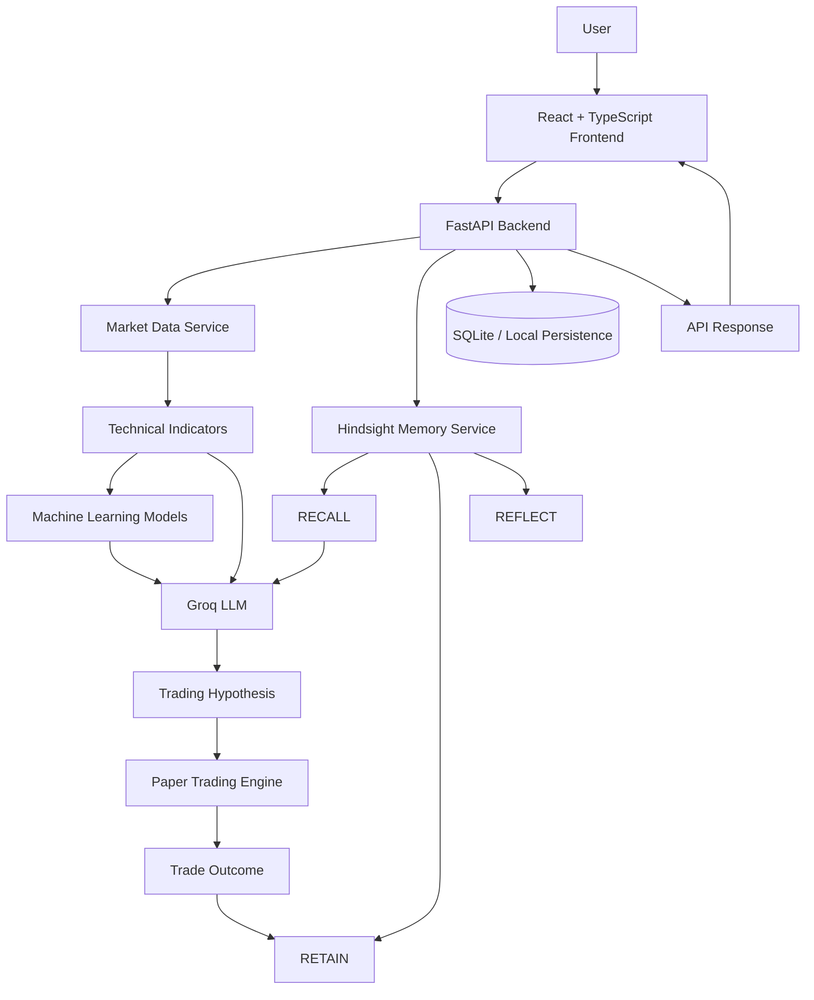

# TradeMind AI — Intelligent Trading Research & Experiential Memory

<p align="center">
  <strong>An AI-powered quantitative trading research platform that combines technical analysis, machine learning, LLM reasoning, and persistent agent memory.</strong>
</p>

<p align="center">
  <a href="https://github.com/naraenks2007-lgtm/TradeMind">GitHub Repository</a> ·
  <a href="https://hindsight.vectorize.io/">Hindsight Documentation</a> ·
  <a href="https://github.com/vectorize-io/hindsight">Hindsight GitHub</a>
</p>

---

## Overview

**TradeMind** is an AI-assisted trading research platform designed to explore how persistent memory can improve the reasoning of an AI trading agent.

Traditional AI assistants can analyze a market snapshot, but they often fail to retain useful experiences from previous interactions. TradeMind addresses this limitation by integrating **Vectorize Hindsight**, allowing the system to retain relevant experiences, recall similar historical situations, and reflect on previous outcomes.

The platform combines:

- **Python-based quantitative analysis** for technical indicators and market calculations.
- **Machine Learning** for market direction and volatility analysis.
- **Groq LLM** for generating structured trading hypotheses and explanations.
- **Vectorize Hindsight** for long-term experiential memory.
- **Paper Trading** for evaluating hypothetical trading decisions without risking real money.
- **Historical Market Replay** for testing strategies against historical market data.

The central idea is simple:

> An AI trading agent should not only analyze what is happening now. It should also be able to use what it has learned from previous market experiences.

## The Problem

An AI model can generate a market analysis using the information available in a single interaction. However, without a persistent memory layer, useful experiences and previously learned preferences may not be available in future interactions.

For example:

1. An agent identifies a possible NIFTY buying opportunity.
2. The market later reverses, resulting in a simulated loss.
3. The agent should retain the market conditions and outcome.
4. When a similar setup appears again, it should recall the previous experience.
5. Its next analysis can consider that experience before generating a new hypothesis.

TradeMind explores this memory-driven approach through Hindsight.

## Key Features

### 1. Quantitative Market Analysis

TradeMind calculates technical indicators using Python rather than asking an LLM to invent numerical indicator values.

Supported indicators include:

| Indicator | Configuration | Purpose |
|---|---|---|
| RSI | 14 periods | Momentum and overbought/oversold analysis |
| EMA | 20, 50, 200 | Trend identification |
| MACD | 12, 26, 9 | Momentum and trend changes |
| Bollinger Bands | 20 periods, 2 standard deviations | Volatility and price ranges |
| ATR | 14 periods | Volatility measurement |

Supported example instruments include:

- NIFTY 50
- BANK NIFTY
- RELIANCE
- TCS
- INFY

Users can also work with custom OHLCV CSV data.

### 2. Machine Learning Analysis

TradeMind uses tabular machine-learning models to analyze numerical market features.

The project includes model approaches for:

- Market direction classification using Random Forest.
- Volatility estimation using Gradient Boosting.
- Volume-flow analysis for market sentiment.

The ML layer provides numerical signals that can be combined with technical indicators and historical context.

**Important:** Model outputs are estimates, not guarantees of future market performance.

### 3. AI Trading Hypothesis Generation

TradeMind integrates the Groq API to generate structured trading hypotheses.

The LLM receives relevant market information, technical indicators, model outputs, and available historical memory.

A hypothesis can include:

- Instrument
- Market direction: bullish, bearish, or neutral
- Hypothesis explanation
- Supporting evidence
- Confidence estimate
- Entry assumption
- Stop-loss assumption
- Target assumption
- Invalidation conditions
- Risk explanation

The LLM is used for reasoning and explanation. Deterministic Python calculations remain responsible for technical indicator values and trading calculations.

### 4. Persistent Agent Memory with Hindsight

This is the central feature of TradeMind.

TradeMind integrates **[Vectorize Hindsight](https://github.com/vectorize-io/hindsight)** to provide an experiential memory layer.

Hindsight provides three important capabilities:

| Operation | Role in TradeMind |
|---|---|
| RETAIN | Store market conditions, hypotheses, relevant preferences, and available paper-trading outcomes |
| RECALL | Retrieve relevant previous experiences when evaluating a new market situation |
| REFLECT | Analyze accumulated experiences to identify useful lessons |

#### Example: Memory-driven trading analysis

**Without memory**

An agent receives an RSI value of 74 and generates an analysis using only the current market information.

**With memory**

The agent recalls a previous experience where an overbought RSI setup was followed by a market reversal. It can consider that experience when evaluating the new setup.

The objective is to make future reasoning context-aware rather than treating every market interaction as an isolated event.

#### Memory workflow

```text
New Market Situation
        |
        v
  Technical Analysis
        |
        v
  Hindsight RECALL
        |
        v
  Previous Experiences
        |
        v
  Groq LLM Reasoning
        |
        v
  Trading Hypothesis
        |
        v
  Paper Trading Evaluation
        |
        v
  Hindsight RETAIN
        |
        v
  Hindsight REFLECT
        |
        v
  Future Context-Aware Analysis
```

**Memory is not model retraining.** Hindsight stores and retrieves experiences that can be supplied as context to the LLM. It does not automatically modify the underlying LLM's weights.

If Hindsight credentials are unavailable, the application should report its unavailable memory status rather than presenting simulated memory results as real Hindsight responses.

### 5. Memory vs. No-Memory Experiment Lab

TradeMind includes a comparison approach for evaluating the potential value of persistent memory.

- **Agent A — No Memory:** Evaluates market scenarios without historical experiential memory.
- **Agent B — With Memory:** Evaluates the scenarios using relevant recalled experiences.

The comparison is intended to examine:

- Directional accuracy
- Win rate
- Simulated cumulative return
- Repeated known mistakes

The purpose is to investigate whether access to relevant previous experiences can improve an agent's decisions.

### 6. Paper Trading Engine

TradeMind includes a simulated trading environment with an initial virtual capital of **₹1,00,000**.

The paper-trading engine supports:

- Simulated buy and sell orders
- Position quantity and entry price
- Stop-loss and target assumptions
- Realized and unrealized P&L
- Brokerage and transaction-cost assumptions
- Slippage simulation
- Account reset

The configured demonstration cost assumptions include:

- Brokerage and taxes: 0.03%
- Slippage: 0.02%

Paper trading is intended for experimentation and evaluation. **TradeMind does not place real-money orders through this paper-trading engine.**

### 7. Historical Market Replay

Historical replay allows users to examine market scenarios using historical OHLCV data.

The project supports historical market datasets and custom CSV uploads.

Historical replay is particularly useful when:

- Testing a trading hypothesis.
- Comparing market conditions.
- Examining technical indicator behaviour.
- Evaluating paper-trading decisions.
- Exploring how recalled experiences affect an agent's reasoning.

Historical and synthetic demonstration data must not be interpreted as live market quotes.

### 8. Optional Upstox Integration

TradeMind includes an Upstox integration layer for broker connectivity and OAuth-based authorization.

Upstox is an optional integration. The core historical-data and paper-trading demonstration does not require an active Upstox account or broker authorization.

Broker access depends on account eligibility, application approval, and the permissions enabled by the provider.

---

## System Architecture



### Technology Stack

| Layer | Technology |
|---|---|
| Frontend | React 18, TypeScript, Vite |
| UI styling | Tailwind CSS |
| Backend | Python, FastAPI |
| AI inference | Groq API |
| LLM | `openai/gpt-oss-120b` (configurable) |
| Agent memory | Vectorize Hindsight |
| Memory SDK | `hindsight-client` |
| Data processing | Pandas, NumPy |
| Technical indicators | `ta` |
| Machine learning | Scikit-learn |
| Market data | yfinance and historical OHLCV CSV files |
| Persistence | SQLite |
| Broker integration | Upstox OAuth |

## Project Structure

```text
TradeMind/
│
├── backend/
│   ├── api/
│   │   ├── health.py
│   │   ├── market.py
│   │   ├── hypothesis.py
│   │   ├── memory.py
│   │   ├── paper_trading.py
│   │   ├── experiment.py
│   │   ├── loop.py
│   │   ├── replay.py
│   │   └── upstox.py
│   │
│   ├── services/
│   │   ├── llm_service.py
│   │   └── hindsight_service.py
│   │
│   ├── main.py
│   └── config.py
│
├── frontend/
│   ├── src/
│   ├── public/
│   ├── package.json
│   └── vite.config.ts
│
├── data/
│   └── historical/
│
├── scripts/
│   ├── download_market_data.py
│   ├── validate_market_data.py
│   └── test_backend.py
│
├── docs/
│
├── .env.example
├── requirements.txt
└── README.md
```

*The tree above highlights the main project areas; individual files and folders may vary between branches.*

---

## Getting Started

### Prerequisites

Install the following:

- Python 3.10 or newer
- Node.js 18 or newer
- npm
- Git

API credentials:

- Groq API key
- Hindsight API key for persistent Hindsight memory

Upstox credentials are optional.

### 1. Clone the Repository

```bash
git clone https://github.com/naraenks2007-lgtm/TradeMind.git

cd TradeMind
```

### 2. Create a Python Virtual Environment

**Windows:**

```bash
python -m venv .venv

.venv\Scripts\activate
```

**Linux / macOS:**

```bash
python3 -m venv .venv

source .venv/bin/activate
```

### 3. Install Backend Dependencies

```bash
pip install -r requirements.txt
```

### 4. Configure Environment Variables

Copy the example environment file:

```bash
copy .env.example .env
```

On Linux or macOS:

```bash
cp .env.example .env
```

Configure the relevant values in `.env`:

```env
GROQ_API_KEY=your_groq_api_key
GROQ_MODEL=openai/gpt-oss-120b

HINDSIGHT_API_KEY=your_hindsight_api_key
HINDSIGHT_BASE_URL=https://api.hindsight.vectorize.io

PORT=8000
HOST=0.0.0.0
```

Use the actual variable names in the repository's `.env.example` and configuration file if they differ.

Never commit your `.env` file or expose API credentials publicly.

### 5. Prepare Historical Market Data

Download or refresh the historical market datasets:

```bash
python scripts/download_market_data.py
```

Validate the available datasets:

```bash
python scripts/validate_market_data.py
```

You can also use supported custom OHLCV CSV files.

### 6. Start the Backend

From the project root:

```bash
python -m uvicorn backend.main:app --reload --host 127.0.0.1 --port 8000
```

The API will be available at:

```text
http://localhost:8000
```

FastAPI interactive documentation:

```text
http://localhost:8000/docs
```

### 7. Start the Frontend

Open another terminal:

```bash
cd frontend

npm install

npm run dev
```

Open the local URL printed by Vite in your browser.

### 8. Build the Frontend

To create a production frontend build:

```bash
cd frontend

npm run build
```

Return to the project root and start the backend. The FastAPI application is configured to serve the built frontend when `frontend/dist` is available.

---

## Demonstration Workflow

A typical TradeMind demonstration follows this sequence:

1. **Load market data:** Select an instrument or provide historical OHLCV data.
2. **Analyze the market:** Calculate technical indicators and obtain model outputs.
3. **Recall experiences:** Retrieve relevant historical experiences from Hindsight when configured.
4. **Generate a hypothesis:** Use Groq to synthesize the available evidence and context.
5. **Evaluate the hypothesis:** Examine the proposed assumptions and risk conditions.
6. **Run paper trading:** Evaluate a hypothetical position using simulated execution.
7. **Retain the outcome:** Store relevant experiences for possible use in future analysis.
8. **Compare agents:** Examine the no-memory and memory-enabled approaches in the experiment workflow.

---

## API Documentation

The backend exposes FastAPI routes for the major application modules.

| Module | Purpose |
|---|---|
| Health | Backend health and availability |
| Market | Market data and market analysis |
| Hypothesis | AI-generated trading hypotheses |
| Memory | Hindsight memory operations |
| Paper Trading | Simulated orders and portfolio operations |
| Experiment | Memory vs. no-memory comparison |
| Loop | Multi-stage trading workflow |
| Replay | Historical market replay |
| Upstox | Optional broker authorization and integration |

For the exact route paths, request schemas, and response formats, run the backend and open:

**http://localhost:8000/docs**

---

## Security and Responsible Use

TradeMind is an experimental research and paper-trading project.

- API keys must be stored in environment variables.
- Never upload credentials or private broker tokens to GitHub.
- Historical prices are not live market quotes.
- Synthetic fallback data must be identified as demonstration data.
- Machine-learning predictions and LLM hypotheses are not guaranteed to be correct.
- Paper-trading performance does not establish real-world profitability.
- Upstox integration is optional and does not imply that live order execution is enabled.
- The current prototype should not be treated as a production multi-user financial service. Authentication, strict user-level data isolation, and production security controls require further hardening.

**Nothing in TradeMind constitutes financial advice or a recommendation to buy or sell securities.**

---

## Current Scope and Limitations

TradeMind is an evolving prototype. Its goal is to demonstrate the combination of quantitative market analysis, LLM reasoning, paper trading, and persistent agent memory.

The following distinctions are important:

- Hindsight memory requires valid service configuration and connectivity.
- Historical replay is different from live market execution.
- ML predictions are probabilistic estimates.
- A retained memory is not automatically a verified trading rule.
- Memory retrieval does not fine-tune the underlying LLM.
- Optional broker connectivity depends on provider authorization and account permissions.
- Production deployment requires additional authentication, data isolation, monitoring, and security validation.

---

## Future Improvements

Potential areas for further development include:

- Stronger per-user and per-session memory isolation.
- More comprehensive evaluation of memory-enabled versus memory-free agents.
- Expanded historical datasets and market coverage.
- Additional ML models and validation methods.
- More robust risk-management and portfolio analytics.
- Automated testing and continuous integration.
- Production-grade authentication and deployment.
- A developer SDK for integrating TradeMind's agent capabilities into other applications.

---

## Acknowledgements

TradeMind builds on the work of several open-source and developer platforms:

- **[Vectorize Hindsight](https://github.com/vectorize-io/hindsight)** — long-term agent memory.
- **[Groq](https://groq.com/)** — LLM inference.
- **[FastAPI](https://fastapi.tiangolo.com/)** — backend API framework.
- **[React](https://react.dev/)** — frontend library.
- **[yfinance](https://github.com/ranaroussi/yfinance)** — historical market data access.

---

## Project Links

| Resource | Link |
|---|---|
| TradeMind GitHub | https://github.com/naraenks2007-lgtm/TradeMind |
| Hindsight GitHub | https://github.com/vectorize-io/hindsight |
| Hindsight Documentation | https://hindsight.vectorize.io/ |
| Vectorize — Agent Memory | https://vectorize.io/what-is-agent-memory |

---

<p align="center">
  <strong>TradeMind — From Market Analysis to Experience-Driven AI.</strong>
</p>

<p align="center">
  Built to explore how persistent memory can make AI agents more context-aware.
</p>
